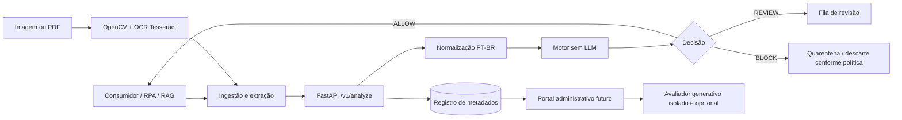

# Arquitetura — Guardião PT-BR

## Objetivo
Inspecionar conteúdo antes que um agente o consuma, devolvendo `ALLOW`, `REVIEW` ou `BLOCK`. O endpoint de análise não utiliza LLM. IA generativa é permitida apenas para preparar exemplos sintéticos revisados e, futuramente, apoiar um avaliador isolado no portal.

## Componentes
1. **Consumidores**: agente, pipeline RAG e robô RPA.
2. **Ingestão**: normaliza e-mails/HTML e converte imagem/PDF digitalizado em texto via OCR. O contrato MVP recebe texto, não arquivos binários.
3. **API FastAPI**: valida JSON, autentica por API key configurada, limita tamanho e chama o motor.
4. **Motor**: baseline simbólico atual; B1 TF-IDF + classificador clássico e modelo Transformer são etapas futuras.
5. **Registro**: SQLite no protótipo; persistência de metadados e hash, sem texto bruto por padrão.
6. **Portal**: futuro front-end para painel, histórico e revisão humana.



## Contrato de ingestão
```json
{
  "request_id": "uuid-opcional",
  "source_type": "rag",
  "content": "Texto extraído a ser inspecionado",
  "content_type": "text/plain",
  "metadata": {"document_id": "doc-001", "hidden_text_extracted": false}
}
```

Valores permitidos para `source_type`: `user`, `email`, `web`, `rag`, `document`, `image`. O campo é obrigatório. Para imagem/PDF, a camada de ingestão deve extrair texto antes da chamada.

## Falha segura
Timeout, indisponibilidade ou erro da API não devem ser tratados como `ALLOW`. O consumidor deve reter para revisão (`REVIEW`) e impedir ações sensíveis até obter decisão válida. `ALLOW` não substitui autorização, privilégio mínimo nem confirmação humana.

## Estado de implementação
A API no scaffold implementa apenas um baseline simbólico de demonstração e grava metadados mínimos em SQLite. OCR, RPA, portal, TF-IDF, DeBERTa/LoRA e calibração ainda não estão implementados. Os scores do baseline são heurísticos, não probabilidades calibradas.
